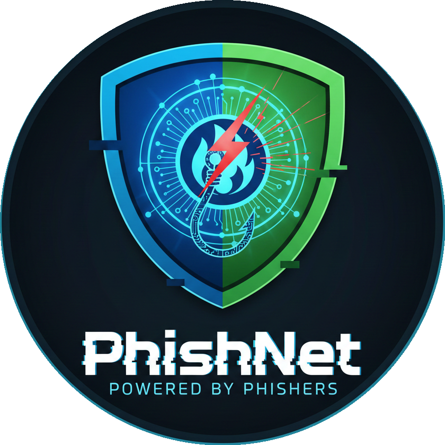
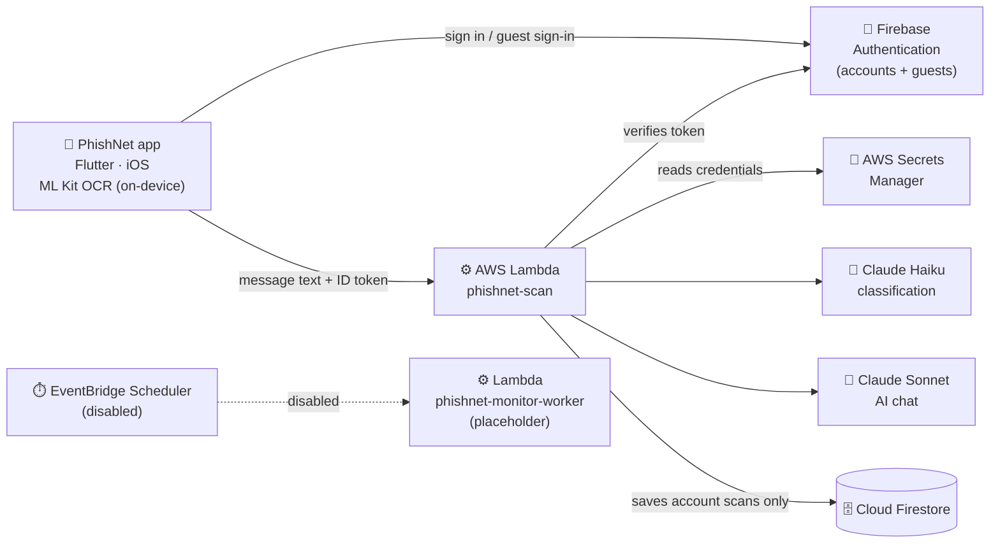

<p align="center">
  
</p>

<h1 align="center">PhishNet</h1>

<p align="center"><strong>A clearer, calmer way to navigate suspicious messages.</strong></p>

<p align="center">
  A student-led project built by the <strong>Phishers</strong><br>
  to help older adults and people less comfortable with technology stay safe from scams.
</p>

<p align="center">
  
  
  
  
  
  
</p>

<p align="center">
  <a href="#-our-mission">Mission</a> ·
  <a href="#-the-problem">Problem</a> ·
  <a href="#-how-phishnet-helps">Solution</a> ·
  <a href="#-project-status">Status</a> ·
  <a href="#-roadmap">Roadmap</a> ·
  <a href="#-infrastructure">Infrastructure</a> ·
  <a href="#-get-started">Get started</a>
</p>

---

## 🎯 Our mission

> **Everyone deserves to feel safe online, no matter their age or how
> comfortable they are with technology.**
>
> PhishNet exists to replace fear and confusion with clear explanations and
> confident next steps, so no one has to face a suspicious message alone.

---

## 🚨 The problem

Scam and phishing messages are getting more convincing every year, and the
people hit hardest are often **older adults and people less comfortable with
technology**. A fake bank alert or "package delivery" text can look completely
real, and the tools meant to help usually respond with jargon, warnings, and
technical terms that add to the stress.

The result is a hard choice: click and risk it, or ignore a message that might
have been real.

---

## 💡 How PhishNet helps

PhishNet is an iOS app that puts **plain-language explanations and practical
next steps ahead of technical jargon**. It is built to feel calm, clear, and
respectful, never rushed or condescending.

| Step | What you do | What PhishNet gives you |
| --- | --- | --- |
| **1. Share** | Enter a suspicious message on the **Capture** screen. | Sprint 2 added photo capture and on-device text recognition, so screenshot images do not need to be uploaded. |
| **2. Understand** | Read the **Results** screen. | A plain-language breakdown of the warning signs, with no technical terms. |
| **3. Decide** | Ask a follow-up in **AI Chat** if you are unsure. | Clear, practical next steps, plus detailed explanations on request. |

**Looking out for each other.** PhishNet will also keep a **History** of your
past scans, offer optional Gmail inbox monitoring (Gmail accounts only) with alerts, and include a
**Family/Social** screen so loved ones can help each other spot scams.

> [!NOTE]
> PhishNet is designed to support informed decisions. It does not replace your
> judgment, and it cannot guarantee that every scam will be identified.

---

## 🚦 Project status

PhishNet is **in active development**. The roadmap describes planned
milestones, not features that are available today.

| ✅ Built so far | 🛠️ Planned |
| --- | --- |
| Firebase Email/Password authentication | History of saved scans and a Home dashboard |
| Signup validation for Gmail and Yahoo addresses (Live Monitoring: Gmail only) | Gmail inbox monitoring is built and tested; always-on poll runs every 5 minutes |
| Email verification and verified-account login checks | Family/Social sharing and scam-pattern insights |
| Password reset by email | Saved AI Chat conversations |
| Guest access to the capture flow | |
| Screen foundations: capture, results, AI chat, family/social, history, settings, and payment plans | |
| Shared, accessible styling across the app | |
| Capture and Results screens connected to Claude (scam analysis, photo capture, text recognition) | |
| AI Chat for follow-up questions | |
| Payment-plan backend | |
| Guest mode with Firebase Anonymous sign-in (guest scans are not saved) | |
| Trusted Contacts: up to 5 favorites with phone numbers, opened in Messages with the scan | |

Follow day-to-day progress on the
**[GitHub project board](https://github.com/users/Shiv05-code/projects/2)**.

---

## 🗺️ Roadmap

The team is working in **four two-week sprints**. Dates are planned sprint
windows and scheduled demos, and may change as work progresses.

| Sprint | Window | Demo | Goal |
| --- | --- | --- | --- |
| **1 · Foundations** | Sep 30 – Oct 14, 2026 | Oct 21 | Accessible sign-in and account management, navigation and Settings, Payment Plans experience, Firebase and Claude prepared |
| **2 · Message checking** | Oct 15 – Oct 28, 2026 | Nov 4 | Capture and Results connected to Claude scam analysis, photo capture and on-device OCR, AI Chat, Firestore scan storage, Gmail monitoring setup begins |
| **3 · Monitoring and history** | Oct 29 – Nov 11, 2026 | Nov 18 | History and Home dashboard, Gmail monitoring with alerts (Gmail accounts only) |
| **4 · Sharing and polish** | Nov 12 – Nov 25, 2026 | Dec 2 (final demo) | Family/Social sharing, saved AI Chat conversations, scam-pattern insights, Payment Plans improvements |

<details>
<summary><strong>What each sprint delivers</strong></summary>

<br>

**Sprint 1 — Foundations**
- Sign-in, sign-up, verification, password recovery, account settings, and account deletion
- Accessible navigation (Home and Menu) and legal-information screens (Terms & Conditions and Privacy Policy)
- Firebase data services and Claude API integration prepared for Sprint 2
- Payment Plans interface and supporting setup

**Sprint 2 — Message checking**
- Capture supports text entry and photo capture, with on-device OCR for screenshots
- Capture and Results connected to Claude-powered scam analysis
- Scan assessments saved to Firestore
- Claude integrated into the AI Chat experience
- AWS setup begins for Gmail email monitoring

**Sprint 3 — Monitoring and history**
- History screen with saved scans and recent detections
- Home dashboard with analytics
- Gmail authorization, monitoring, and push alerts for flagged messages (Gmail accounts only). Built and verified on iPhone; always-on poll runs every 5 minutes

**Sprint 4 — Sharing and polish**
- Family/Social screen with sharing through the iOS Share Sheet
- Saved AI Chat conversations and recurring scam-pattern insights
- Payment Plans backend improvements and final feature polish

</details>

---

## 🏗️ Infrastructure

PhishNet is an iOS-focused Flutter app backed by Firebase, AWS, and Claude.
**Firebase Authentication, AWS Lambda, Secrets Manager, Firestore, and Claude are in use. 
Gmail Live Monitoring is built and verified on iPhone, but scheduled checks are off until end-to-end testing is complete. Live Monitoring works with Gmail accounts only.**



### Frontend

| Tool | Purpose |
| --- | --- |
| **Flutter and Dart** | The iOS-focused mobile app |
| **Xcode and iOS Simulator** | iOS development and visual testing |
| **Google ML Kit** | On-device text recognition for screenshots, used by Capture |
| **iOS Share Sheet** | Family and social sharing |
| **Figma, SF Symbols, Google Fonts** | Design, icons, and typography |
| **Apple Developer Account** | TestFlight and App Store distribution |

### Backend

| Service | Status | Purpose |
| --- | --- | --- |
| **Firebase Authentication** | Integrated | Email/password accounts and Anonymous sign in for guest mode |
| **Cloud Firestore** | In use | Single database for scan history, chat records, device push tokens, and monitoring status |
| **Firebase Cloud Messaging** | In use (iOS) | Phishing alerts on iPhone, delivered through Apple Push Notification service (APNs). Android deferred |
| **Claude Haiku** | In use | Fast, routine message and email classification |
| **Claude Sonnet** | In use | AI Chat and more detailed explanations |
| **Google OAuth 2.0 (Gmail)** | In use | Read-only `gmail.readonly` consent for Live Monitoring. Gmail accounts only |
| **AWS Lambda (`phishnet-scan`)** | Deployed | Verifies the Firebase ID token (account or guest), then calls Claude. Region us-east-2. See [`docs/backend-scan-api.md`](docs/backend-scan-api.md) |
| **AWS Secrets Manager** | In use | Secret `phishnet/prod` holds the Claude key and Firebase service account |
| **Amazon EventBridge Scheduler** | Not created | Planned daily schedule (12:00 Pacific) for Gmail checks. Not created until end-to-end testing passes |

### Privacy by design

- **Screenshots stay on the phone.** Text recognition runs on the device, so images are not uploaded.
- **Verified in code (`backend/lambda/handler.py`):** the scan endpoint does not store message text or log it. It saves only the analysis result (risk level, summary, red flags, next steps) and a timestamp to the user's scans. Account deletion removes the account-linked scan records and profile, but copies each scan's analysis fields to `anonymized_training_scans` without user IDs. Those unlinked assessments remain and may contain personal details from messages. No model training code exists in this repository. The app’s Delete My Account currently removes Firestore data directly and does not call the Lambda deletion action. Guest (Anonymous) users can scan, but their scans are not saved, and history and account deletion are denied for them.
- **Users stay in control.** Gmail access requires explicit consent (read-only) and can be turned off at any time on the Home screen. Live Monitoring works with Gmail accounts only.
- **Trusted Contacts are opt-in.** Phone numbers are saved only when a user picks a contact, are stored in that user's Firestore account, are readable only by that user, and are removed when the contact is deleted or the account is deleted. PhishNet never sends a message on the user's behalf; the user taps Send in Messages.
- **Credentials stay out of the app.** The Claude API key and Firebase service account are read from AWS Secrets Manager (`phishnet/prod`) by the Lambda. They are not in the app, the repository, or environment variables, and the code never logs them.
- **Restricted data.** Gmail refresh tokens are stored only in the backend secret, never on the device or in the app. Monitoring status is read from the backend, and email content is never logged.

### Validation requirements

Anything that can change what a user is told must pass these checks before it ships. Tests for each rule live in `backend/tests` and `test`.

- **Scan results (enforced in `handler.py`).** The score is a whole number from 0 to 100 and the risk level must match it (low 0-33, medium 34-66, high 67-100). The one-sentence description is 15 words or fewer, the summary is 30 words or fewer, and there are 1 to 3 next steps of 10 words or fewer. Red flags use a known category. A result that fails any check is retried once, then returns an error instead of a guess.
- **AI Chat (enforced in `handler.py`).** A question is 1,000 characters or fewer, the backend reads only the last 10 turns, and answers are capped at 1,200 characters. Chat features that only reuse what is already on the phone, such as showing a scan or carrying a summary into a new chat, send nothing and do not count toward the daily limit.
- **Scam-pattern insights (`backend/lambda/pattern_insights.py`).** A pattern needs an ID like `PI-001`, a known red-flag category, and short text. It may not contain an email address, link, phone number or account number. Only `approved` patterns, with a named reviewer and review date, can reach the prompt, and only when `PATTERN_INSIGHTS_ENABLED=true`. Run `python backend/scripts/check_patterns.py` before changing the library.
- **Privacy.** Message text is never stored or logged. Insight and training data may hold analysis fields and hand-written examples only, never text copied from a user's message.
- **Before merging.** One teammate approves the PR and the CI checks pass. Changes that touch the Lambda also need `python -m unittest discover -s tests` run from `backend/`, and a deploy is done by the owner after the merge.

---

## 🚀 Get started

**Requirements:** the [Flutter SDK](https://docs.flutter.dev/get-started/install)
and Xcode with an iOS Simulator (or a connected iPhone). The iOS target
requires iOS 15 or newer because of the Firebase packages.

```bash
flutter pub get
flutter run
```

Check code quality and run tests:

```bash
flutter analyze
flutter test
```

<details>
<summary><strong>Firebase setup for a new checkout</strong></summary>

<br>

The app uses Firebase project `phishnet-b93e0` and the iOS bundle identifier
`com.Phishers.PhishNetApp`. The generated configuration currently targets iOS.

1. Install the [Firebase CLI](https://firebase.google.com/docs/cli) and sign in with an account that has access to the project:

```bash
   firebase login
```

2. Install the FlutterFire CLI:

```bash
   dart pub global activate flutterfire_cli
```

3. From the project root, configure iOS:

```bash
   flutterfire configure \
     --project=phishnet-b93e0 \
     --platforms=ios \
     --ios-bundle-id=com.Phishers.PhishNetApp
```

4. Enable **Email/Password** under Firebase Console → Authentication → Sign-in method. Also enable Anonymous (guest mode).

> [!WARNING]
> Do not commit credentials, debug logs, or generated build artifacts. Share
> environment-specific Firebase configuration only through the project's
> approved source-control process.

</details>

<details>
<summary><strong>Project structure</strong></summary>

<br>

```text
lib/
├── main.dart                    # Firebase initialization and app entry point
├── firebase_options.dart        # FlutterFire-generated platform configuration
├── models/                      # Application data models
├── screens/                     # Feature and authentication screens
├── services/
│   ├── auth_service.dart        # Firebase Auth operations and error mapping
│   └── auth_validation.dart     # Shared signup validation rules
├── theme/                       # App-wide colors and authentication theme
└── widgets/                     # Reusable UI components and transitions

test/
├── auth_validation_test.dart    # Signup validation unit tests
└── widget_test.dart             # Authentication and navigation widget tests
```

</details>

<details>
<summary><strong>Regenerate the app icon</strong></summary>

<br>

After changing `assets/images/phishnet_logo.png`, run:

```bash
dart run flutter_launcher_icons
```

</details>

<details>
<summary><strong>Troubleshooting an iOS build</strong></summary>

<br>

```bash
flutter clean
flutter pub get
flutter run
```

</details>

---

<p align="center">
  <strong>Built by students, for the people we care about.</strong><br>
  <sub>Questions or ideas? Open an issue or visit the
  <a href="https://github.com/users/Shiv05-code/projects/2">project board</a>.</sub>
</p>